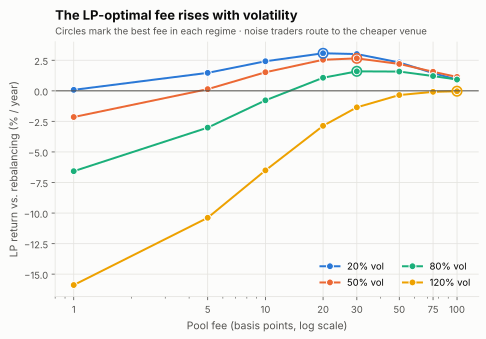
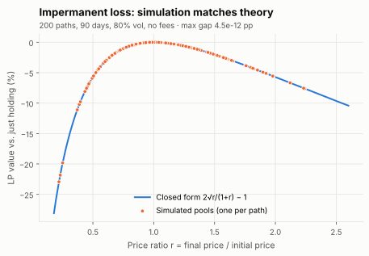
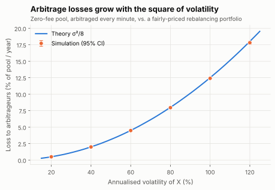
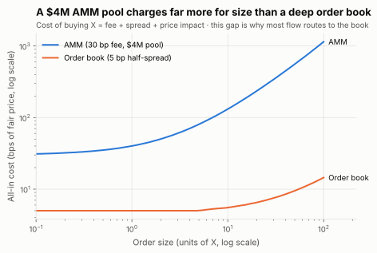
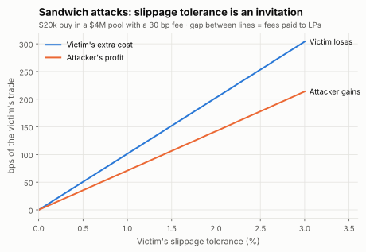

# Liquidity Leak
### How arbitrageurs quietly drain DeFi liquidity pools, and the fee that best protects liquidity providers

*Liquidity Leak* is a Monte Carlo study of **automated market makers** (the Uniswap-style pools behind
decentralised exchanges) against a traditional **limit order book**. It answers
three questions a trading desk, a DeFi protocol or a market regulator would ask:

1. **How much do liquidity providers (LPs) lose to arbitrageurs, and why?**
2. **What fee should a pool charge?** And how does the answer depend on volatility?
3. **How much do traders lose to front-running ("sandwich attacks")?**

Every number below is reproduced by one command, and the core results are checked
against known closed-form formulas before anything else is trusted.

---

## Key findings

| # | Finding | Evidence |
|---|---------|----------|
| 1 | The simulator reproduces the **impermanent-loss** formula `2√r/(1+r) − 1` to machine precision. | Fig. 1 |
| 2 | With no fee, LPs lose **σ²/8 of pool value per year** to arbitrageurs ("loss-versus-rebalancing"). The simulation is within 1.1% of theory at every volatility tested (e.g. 7.96% vs 8.00% at 80% vol). | Fig. 2 |
| 3 | **The LP-optimal fee rises with volatility.** It is about 20 bps at 20% vol and 30 bps at 50% vol. At 80% vol, 30 bps and 50 bps are statistically tied. At 120% vol, LPs lose money at every fee tested, so high fees only limit the damage. | Fig. 3 |
| 4 | Fees cut both ways: higher fees recover more from arbitrageurs but drive ordinary traders to the order book. The AMM's share of noise-trader volume falls from about 23% at a 1 bp fee to under 4% at 100 bps. | Fig. 3 |
| 5 | A $20k order in a $4M pool costs about **132 bps** on the AMM vs **5.5 bps** on the order book. Pool depth, not the fee, dominates execution cost for size. | Fig. 4 |
| 6 | With a **1% slippage tolerance**, a sandwich attack costs the victim about **101 bps** and earns the attacker about **71 bps**; the difference goes to LPs as fees. The attack is profitable from a tolerance of only 0.05%. | Fig. 5 |

### LP return vs. fee (% of pool per year, mean of 200 paths)

| Volatility | 1 bp | 5 | 10 | 20 | 30 | 50 | 75 | 100 bps | Best fee |
|---|---|---|---|---|---|---|---|---|---|
| 20% | 0.08 | 1.47 | 2.42 | **3.07** | 3.00 | 2.32 | 1.46 | 0.91 | 20 bps |
| 50% | −2.15 | 0.14 | 1.52 | 2.54 | **2.66** | 2.20 | 1.56 | 1.13 | 30 bps |
| 80% | −6.58 | −3.01 | −0.78 | 1.07 | **1.60** | 1.57 | 1.21 | 0.92 | 30–50 bps |
| 120% | −15.89 | −10.39 | −6.51 | −2.86 | −1.35 | −0.35 | −0.09 | **−0.03** | ≥ 100 bps |

Standard errors are 0.002–0.12 percentage points (see `results/summary.json`).

---

## Figures

<p align="center"></p>

| | |
|---|---|
|  |  |
|  |  |

---

## The model in one paragraph

A constant-product pool holds `x` units of a risky token X and `y` units of a
stablecoin Y, and keeps `x·y = k` constant on every trade. Its price is `y/x`.
Each minute, the "true" price (think: the Binance price) moves as a geometric
Brownian motion. An **arbitrageur** then trades the pool back to the true price,
less the fee. With some probability a **noise trader** also arrives with a random
order. She compares the all-in cost of the AMM with that of a centralised
**order book** plus a personal cost of using the exchange, and trades on the
cheaper venue. LP performance is measured against a portfolio that holds the same
amount of X but trades at fair prices (the *rebalancing portfolio* of Milionis
et al., 2022). This isolates the fees LPs earn from the value they leak to
better-informed traders.

Full derivations are in [`docs/MODEL.md`](docs/MODEL.md).

## Project structure

```
src/ammsim/
  amm.py          constant-product pool: swaps, optimal arbitrage, impermanent loss
  orderbook.py    stylised limit order book (spread + depth ladder)
  prices.py       GBM price paths
  simulate.py     vectorised Monte Carlo: arbitrage, noise traders, venue routing
  sandwich.py     optimal front-running against a slippage-tolerant order
  plotting.py     chart style
experiments/run_all.py   reproduces every figure and number
tests/                   14 unit tests, including checks against closed-form theory
docs/MODEL.md            the maths
docs/INTERVIEW_GUIDE.md  plain-English walkthrough and likely interview questions
```

## How to run

```bash
pip install -r requirements.txt
python -m pytest -q                 # 14 tests, < 1 second
python experiments/run_all.py       # all figures + results/summary.json (~45 s)
```

## Design choices worth noting

- **Vectorised Monte Carlo.** All paths *and* all fee levels run as columns of a
  single NumPy array. Every fee level sees identical price paths and identical
  trader arrivals (common random numbers), so differences between fees are
  signal, not simulation noise.
- **Theory first.** Two closed-form results (impermanent loss and LVR = σ²/8) are
  tested before the model is used to answer open questions.
- **Fees held outside the pool** (as in Uniswap v3), so fee income is measured
  explicitly instead of being mixed into reserves.

## Limitations

- Volatility is constant and prices have no jumps. Real crypto prices have
  fat tails, and jumps would raise arbitrage losses.
- The order book has a fixed shape. Real books thin out when volatility spikes,
  which is exactly when the AMM would win more flow.
- Arbitrage happens every minute with no gas costs or block-building
  competition. Gas costs widen the no-trade band and reduce LVR.
- The noise traders' switching cost (mean 25 bps) is an assumption. Results on
  the optimal fee are sensitive to it, and this is the natural next thing to vary.

## References

- Adams, Zinsmeister & Robinson (2020). *Uniswap v2 Core* (whitepaper).
- Angeris & Chitra (2020). *Improved Price Oracles: Constant Function Market Makers.*
- Milionis, Moallemi, Roughgarden & Zhang (2022). *Automated Market Making and Loss-Versus-Rebalancing.*
- Daian et al. (2020). *Flash Boys 2.0: Frontrunning in Decentralized Exchanges.* IEEE S&P.

---

Built with AI assistance (Claude). Licensed under MIT.
